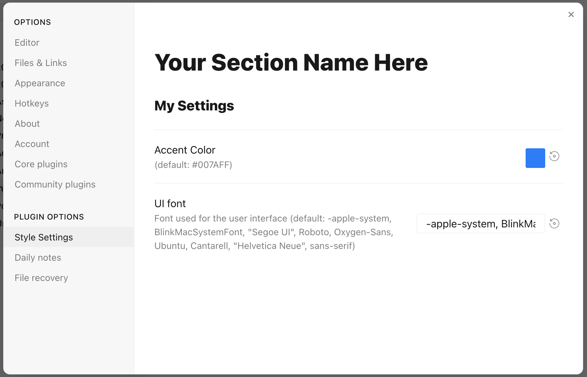

# Style Settings

**Make Obsidian look the way you like, without writing any code.**

Many Obsidian themes and CSS snippets come with options: accent colors, fonts, text sizes, and features you can switch on or off. Style Settings gathers all of those options in one place and gives you simple controls to change them: switches, sliders, dropdowns and color pickers.

## What you can do

- 🎨 **Pick your own colors**, with separate colors for light and dark mode when the theme supports it.
- 🔤 **Change fonts, text sizes and spacing.**
- 🔘 **Turn theme features on and off** with a single switch.
- 🔍 **Search** through every option at once.
- ↩️ **Undo any change** with one click and go back to the theme's original look.
- 💾 **Save your settings to a file** to back them up, move them to another vault or share them with friends.
- ⌨️ **Use hotkeys** for options that the theme author made available as commands.

Every change shows up immediately, so you can experiment freely.

## Before you start

Style Settings shows the options that your **theme** or **CSS snippets** offer. It doesn't add options of its own.

- Many community themes support Style Settings. The theme's description usually says so.
- Using Obsidian's default theme? Download [this ready-made snippet](docs/obsidian-default-theme.css) to adjust almost every color and size of the default theme. Put the file in your vault's `.obsidian/snippets` folder, then turn it on in **Settings** → **Appearance** → **CSS snippets**.

## Installing

### From Obsidian

1. Open **Settings** → **Community plugins**.
2. If Obsidian asks, click **Turn on community plugins**.
3. Click **Browse**, search for **Style Settings**, then click **Install** and **Enable**.

### This version, by hand

This repository is an updated version of the original plugin with extra fixes. To use it instead:

1. Open the [Releases page](https://github.com/hectoresoto/obsidian-style-settings-v2/releases) and download `main.js`, `manifest.json` and `styles.css` from the latest release.
2. Open your vault folder on your computer, then the hidden `.obsidian` folder, then `plugins`. *Can't see `.obsidian`? On Windows, choose **View** → **Show** → **Hidden items** in File Explorer. On a Mac, press **Cmd + Shift + .** in Finder.*
3. Inside `plugins`, open (or create) a folder named `obsidian-style-settings` and put the three files there, replacing any files with the same name.
4. Restart Obsidian, then turn on **Style Settings** in **Settings** → **Community plugins**.

## Using Style Settings

1. Open **Settings** and choose **Style Settings** in the left sidebar.
2. Each theme or snippet has its own section. Click its name to open it.
3. Change whatever you like. The new look is applied right away.

**Prefer a side panel?** Open the command palette (**Ctrl + P**, or **Cmd + P** on a Mac) and run **Style Settings: Show style settings view**. You can keep it open next to your notes while you try things out.

### Going back to the original look

- The ↺ button next to an option resets just that option.
- The ↺ button next to a section name resets the whole section.

### Backing up and sharing your settings

- **Export**, at the top of the page, lets you copy all your settings or download them as a file. The export button next to a section saves only that section.
- **Import** lets you paste settings or load a file you exported before.

## Something isn't working?

### "No style settings found"

Your current theme and snippets don't offer any options. Check that your theme supports Style Settings, or that your snippet is turned on in **Settings** → **Appearance** → **CSS snippets**.

### A red error message at the top

The theme or snippet named in the message has a mistake in its options. Everything else keeps working. Let the author of that theme or snippet know.

### Still stuck?

[Open an issue](https://github.com/hectoresoto/obsidian-style-settings-v2/issues) and tell us which theme you use and what you expected to see.

## For theme and snippet authors

Want your own theme or snippet to show options here? Read the [guide for theme and snippet authors](docs/theme-authors.md).

## Credits

Style Settings was created by [mgmeyers](https://github.com/mgmeyers/obsidian-style-settings). This repository continues that work.

## Contributing

Development setup, project layout and CI are described in [CONTRIBUTING.md](.github/CONTRIBUTING.md). Behavior changes start with a spec in [`specs/`](specs/README.md); [`CLAUDE.md`](CLAUDE.md) gives AI coding assistants the same rules.
